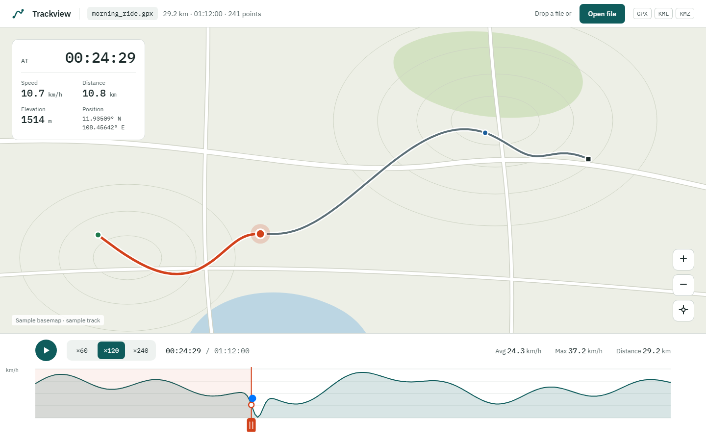

# TripRender

**Trackview** is a desktop app that replays a recorded GPS trip (GPX / KML / KMZ) on a real online map
and renders it to video. It is a Vite + TypeScript web UI in a Tauri 2 shell for Windows. Android may follow later.



## Features

- **Open tracks** with the file picker or drag and drop: GPX, KML and KMZ (including Geo Tracker and dashcam exports).
  Files are parsed locally and never uploaded.
- **Replay** at ×N speed. The travelled and remaining parts of the track are drawn in different colours,
  and pauses can be skipped.
- **Info card**: elapsed time, speed, distance, elevation and coordinates at the current position.
- **Speed chart** synced both ways with the map (scrub the chart to move the marker).
- **Handles messy data**: timed, partly timed and untimed tracks; GPS spike removal; derived speed when none is recorded.
- **Follow camera**: north up, heading up or keep in view. *Smart zoom* adapts the zoom to the speed,
  and you can edit its zoom curve by dragging points under the chart.
- **Position marker**: dot, arrow, built-in icons or your own image.
- **Video export**: MP4 (H.264) or WebM, with presets, fit-to-duration, range selection, intro/outro and overlays
  (info card, chart strip, title).
- **Phone view**: previews the map at a phone's screen size and exports phone-scale video
  (e.g. 1080×1920 at pixel ratio 3).
- **Headless map clips for other tools**: `tools/overlay-render.mjs` renders the export map frame by frame
  from a job file, without the UI. dashvid uses it for the corner map in dashcam videos (see below).

The full behaviour, including acceptance criteria and design decisions, is in [`SPEC.md`](SPEC.md).

## Quick start

Requirements: Node.js; for the desktop build, Rust (`winget install Rustlang.Rustup`) and Edge WebView2
(preinstalled on Windows 10/11).

```sh
cd trackview
npm install
npm run dev          # browser at http://localhost:5173
npm run tauri dev    # desktop window with hot reload
```

On Windows, `run_trackview.bat` does the same as `npm run tauri dev`: it installs packages if needed and starts the desktop window.

## Commands (in `trackview/`)

| Command | What it does |
|---|---|
| `npm run dev` | Browser dev server on port 5173 |
| `npm run tauri dev` | Desktop window with hot reload |
| `npm run tauri build` | `src-tauri/target/release/trackview.exe` and an NSIS installer in `src-tauri/target/release/bundle/nsis/` |
| `npm test` | Unit tests (Vitest) against the samples in `example_GPSfiles/` |
| `npm run typecheck` | TypeScript check (`strict`) |

## Map clips for dashvid (headless overlay renderer)

dashvid (`D:\DashTrip\dashvid`) calls this to draw the small real map in the corner of its dashcam videos.
It needs `npm install` done here (it uses `playwright-core` with the installed Chrome or Edge) and internet for the tiles.

```sh
node tools/overlay-render.mjs job.json
```

The job file names the track, the size, the map style and camera, and the clips to render
(start time, rate, frame count); the format is at the top of `tools/overlay-render.mjs` and in SPEC §19.
dashvid writes its jobs to `<trip>\_dashvid\map\job.json`, so a failed run can be repeated by hand with the command above.

## Keyboard

| Key | Action |
|---|---|
| Space | Play / pause |
| ← / → | Step 10 s (Shift: 60 s) |
| Home / End | Jump to start / end |
| `+` / `-` | Next / previous playback speed |
| `P` | Toggle phone view |

## Repository layout

```
trackview/            the app
  src/parse/          XML parser, GPX/KML readers, format detection, KMZ unzip
  src/model/          track building (timing, speed, pauses, spikes), interpolation, units
  src/map/            MapLibre map, track layers, markers, camera, smart zoom, zoom curve
  src/ui/             chart (uPlot), info card, settings, marker panel, zoom strip, phone view
  src/export/         video export: timeline, renderer, overlays, encoder, presets, dialog
  src/overlay/        headless page for map clips (overlay.html), used by tools/overlay-render.mjs
  src/player.ts       playback clock
  src/main.ts         app wiring
  tools/              overlay-render.mjs: renders map clips from a job file (SPEC §19)
  src-tauri/          Tauri 2 shell
  test/               unit tests
example_GPSfiles/     sample tracks used by the tests
SPEC.md               specification
```

## Map data

Basemaps are loaded online and need no API key:
[OpenFreeMap](https://openfreemap.org) (© OpenMapTiles, data © OpenStreetMap contributors) and
Esri World Imagery for the satellite style.
